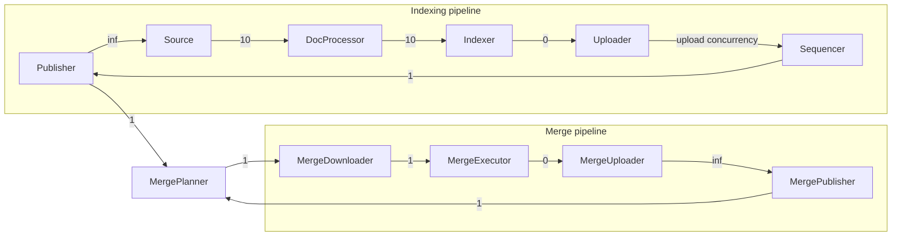

The Indexer serializes and packages splits inline. The MergeExecutor packages merged
splits inline. Serialization I/O metrics use the `indexer` component. Delete-task
pipeline observations report packaging failures under `delete_task_executor`.

Cooperative indexing holds its permit through document indexing, serialization, and
packaging. It releases the permit before waiting on the uploader, so upload congestion
does not consume indexing capacity.

